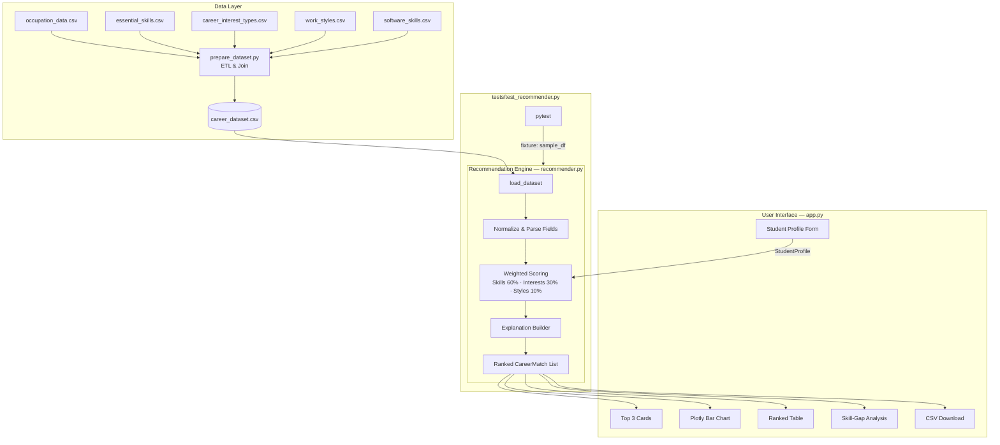

# Explainable Career Recommendation System Using O\*NET Data and Rule-Based Reasoning

> **Academic Project — Cognitive Computing**
> *Powered by O\*NET 31.0 Database · Python · Streamlit · Rule-Based AI*

---

## Abstract

This project implements an Explainable Career Recommendation System that helps students identify suitable IT career paths by comparing their self-reported skills, interests, and preferred work styles with structured occupational data from the O\*NET database. The system applies rule-based reasoning with a transparent weighted scoring formula, explains why each career was recommended, identifies skills the student has not yet reported, and suggests learning priorities. It does not use machine learning, does not train predictive models, and does not claim to predict employment outcomes.

---

## Problem Statement

Students choosing an IT career path often lack structured information about which occupations align with their current skills and interests, what skills they need to develop, and how different careers compare. Generic online career quizzes rarely explain their results. Artificial intelligence–based recommendation systems are opaque and require large labelled datasets that may not reflect local job markets.

---

## Motivation

Cognitive Computing research emphasises systems that augment human decision-making through transparent reasoning. A rule-based, explainable recommender built on authoritative occupational data can provide trustworthy, auditable career guidance that students, counsellors, and faculty can understand and critique.

---

## Objectives

1. Integrate real occupational data (O\*NET) into a structured knowledge base.
2. Implement a transparent, deterministic weighted scoring algorithm.
3. Provide ranked career recommendations with category-level explanations.
4. Identify skills not yet reported by the student and suggest learning priorities.
5. Demonstrate knowledge representation, reasoning, and explainability as Cognitive Computing principles.
6. Deliver a professional web dashboard with no external API dependencies.

---

## Existing Systems and Limitations

| System | Limitation |
|--------|-----------|
| O\*NET Online | No personalised recommendations; requires manual navigation |
| LinkedIn Career Explorer | Proprietary; requires account; results not explained |
| ML-based job recommenders | Black-box predictions; require large training datasets; not interpretable |
| Generic aptitude tests | Not grounded in verified occupational data; no skill-gap analysis |

---

## Proposed System

A local Python/Streamlit application that:

- Loads a cleaned O\*NET-derived dataset of IT occupations.
- Accepts student profiles via a web form.
- Applies a three-category weighted scoring formula.
- Returns ranked career recommendations with full explanations.
- Reports skills not yet in the student's profile, labelled as **not yet reported** (not as confirmed deficits).
- Suggests skills to learn next, drawn directly from O\*NET data.
- Requires no API key, cloud service, or machine-learning model.

---

## Dataset Source and Description

**Source**: O\*NET 31.0 Database, National Center for O\*NET Development, sponsored by the U.S. Department of Labor/Employment and Training Administration (USDOL/ETA).

**URL**: [https://www.onetcenter.org/database.html](https://www.onetcenter.org/database.html)

> ⚠️ O\*NET data is primarily based on US occupational information and may require adaptation for students in other countries, including India. Occupation titles, skill requirements and salary ranges may differ.

Five CSV files are used:

| File | O\*NET Table | Key Information |
|------|-------------|-----------------|
| `occupation_data.csv` | Occupation Data | SOC code, title, description |
| `essential_skills.csv` | Skills | Skill names and importance (IM scale, 1–5) |
| `career_interest_types.csv` | Interests | Holland interest codes and scores (OI scale) |
| `work_styles.csv` | Work Styles | Work-style names and importance |
| `software_skills.csv` | Tools & Technology | Software product names; Hot Technology flag |

---

## Data Preparation and Merging

Run: `python scripts/prepare_dataset.py`

Steps:
1. Read all five CSV files (UTF-8 with latin-1 fallback).
2. Detect occupation-code column names dynamically.
3. Normalize SOC codes (strip trailing `.00`).
4. Filter to approximately 10–20 target IT occupations.
5. Aggregate skills at importance ≥ 3 (IM scale) into semicolon-separated fields.
6. Aggregate interest codes at score ≥ 2 (OI scale) into semicolon-separated fields.
7. Aggregate work styles by importance threshold.
8. Aggregate software skills (Hot Technology filter where available).
9. Join all tables on occupation code (**never by row position**).
10. Remove duplicate codes; report missing values.
11. Save `data/processed/career_dataset.csv`.
12. Write `data/processed/data_dictionary.md`.

---

## System Requirements

- Windows 10/11, macOS 12+, or Linux
- Python 3.10 or later
- 512 MB free disk space
- Modern web browser (Chrome, Edge, Firefox)
- Internet access for initial font loading only (Google Fonts CDN)

---

## Software Requirements

| Package | Version | Purpose |
|---------|---------|---------|
| pandas | ≥ 2.0 | Data loading and aggregation |
| streamlit | ≥ 1.28 | Web dashboard |
| plotly | ≥ 5.17 | Interactive charts |
| pytest | ≥ 7.4 | Automated testing |
| openpyxl | ≥ 3.1 | Excel compatibility (optional) |

---

## Architecture Diagram



---

## Module Descriptions

### `scripts/prepare_dataset.py`
ETL script that reads, cleans, filters, aggregates and joins the five O\*NET CSV files. Fully repeatable; never modifies source files. Outputs `career_dataset.csv` and `data_dictionary.md`.

### `recommender.py`
Core recommendation engine. Contains:
- `StudentProfile` dataclass — holds profile inputs.
- `CareerMatch` dataclass — holds one occupation's results.
- `load_dataset()` — validates and returns the dataset.
- `recommend()` — scores every occupation, sorts by score, returns ranked list.
- `validate_profile()` — checks that at least one input category is provided.
- `_parse_field()`, `_match_count()`, `_normalize()` — low-level helpers.

### `career_data.py`
Utility module that caches the dataset with `lru_cache` and provides sorted, deduplicated picklist functions for the Streamlit UI.

### `app.py`
Streamlit dashboard. Loads dataset on startup; renders sidebar profile form; on submission calls `recommend()` and displays results in seven sections: Top 3 cards · Comparison chart · Ranked table · Skill-gap analysis · Download · Dataset info · Cognitive Computing concepts.

### `tests/test_recommender.py`
58 pytest tests across 14 test classes. Uses an in-memory synthetic CSV fixture; does not require the real O\*NET data.

---

## Scoring Formula and Worked Example

### Formula

```
Skill_Score    = (# career skills matched by student) / (# career skills) × 100
Interest_Score = (# career interests matched) / (# career interests) × 100
Style_Score    = (# career work styles matched) / (# career work styles) × 100

Overall = W_skills × Skill_Score + W_interests × Interest_Score + W_styles × Style_Score
```

Default weights: **W_skills = 0.60, W_interests = 0.30, W_styles = 0.10**

If the student omits a category, its weight is redistributed proportionally among the remaining categories.

### Worked Example

**Student profile:**
- Technical skills: Programming, Critical Thinking, Systems Analysis
- Career interests: Investigative
- Work styles: Analytical Thinking

**Target occupation: Software Developers (15-1252.00)**

| Category | Career Items | Matched | Score |
|----------|-------------|---------|-------|
| Skills | Programming; Critical Thinking; Systems Analysis; Active Listening | 3 of 4 | 75.0 |
| Interests | Investigative; Realistic | 1 of 2 | 50.0 |
| Work Styles | Analytical Thinking; Attention to Detail | 1 of 2 | 50.0 |

```
Overall = 0.60 × 75.0 + 0.30 × 50.0 + 0.10 × 50.0
        = 45.0 + 15.0 + 5.0
        = 65.0 / 100
```

**Skills not yet reported:** Active Listening *(listed for awareness — not a confirmed deficit)*

---

## Cognitive Computing Concepts

| Concept | Implementation |
|---------|---------------|
| **Knowledge Representation** | Structured career dataset derived from O\*NET; each occupation has skills, interests, work styles and software encoded as normalized lists |
| **Reasoning** | Deterministic weighted rule-based scoring; transparent formula with per-category breakdown |
| **Explainability** | Every recommendation includes a written explanation of matched items, score breakdown, and unreported skills |
| **Personalization** | Rankings change with different profile inputs; weights re-normalize when categories are absent |
| **Decision Support** | Side-by-side career comparisons, skill-gap analysis, and learning suggestions |

> This system is **not** a trained machine-learning model and does **not** use generative AI or neural networks.

---

## Installation Instructions

```bash
# 1. Clone or copy the project
cd "d:\cognitive computing\career_recommendation_system"

# 2. Install dependencies
python -m pip install -r requirements.txt

# 3. Prepare the dataset (requires O*NET CSV files in C:\Users\Havila\Downloads\csv_files)
python scripts/prepare_dataset.py
```

---

## Execution Instructions

```bash
# Run the Streamlit dashboard
python -m streamlit run app.py
```

Then open [http://localhost:8501](http://localhost:8501) in a browser.

---

## Test Cases and Results

Run the test suite:

```bash
python -m pytest tests -q -v
```

| Test Class | Tests | Coverage |
|-----------|-------|---------|
| TestDatasetLoading | 6 | Load, required cols, missing dataset, malformed CSV |
| TestOccupationCodeJoin | 2 | Code preservation, no positional join |
| TestDuplicateAndMissing | 2 | Duplicate rows, missing fields |
| TestParseField | 6 | Semicolons, dedup, empty, None, whitespace |
| TestNormalize / TestAliases | 6 | Lowercase, strip, collapse, alias map |
| TestMatchCount | 5 | Exact, substring, no match, empty inputs |
| TestScoreBounds | 5 | Max, zero, partial, empty total, full run |
| TestRankingOrder | 2 | Descending scores, sequential rank numbers |
| TestDeterminism | 1 | Same profile → same results |
| TestProfileDifferences | 3 | Data scientist, web dev, security profiles |
| TestMissingOptionalInputs | 4 | No software, no interests, no styles, education |
| TestEmptyProfileValidation | 3 | Empty profile, whitespace-only |
| TestExplanations | 4 | Explanation present, score in text, disclaimer, matched |
| TestSkillGaps | 4 | Gaps present, no overlap with matched, suggested ⊆ unreported, no "definitely lack" |

---

## Advantages

- Fully transparent and auditable scoring.
- No external API, cloud service or internet required at runtime.
- Directly grounded in authoritative occupational data (O\*NET).
- Skill gaps labelled responsibly (not as confirmed deficits).
- Deterministic: same input always produces the same output.
- Easy to extend: add occupations or change weights without retraining.

---

## Limitations

- O\*NET data reflects US occupations; may not map perfectly to Indian or other markets.
- Skills and interests are self-reported; the system cannot verify them.
- Scoring weights (60/30/10) are heuristic; different weightings may suit different use cases.
- The dataset covers approximately 10–20 IT occupations; broader coverage requires more filtering.
- The system does not account for regional demand, salary, or cultural factors.

---

## Future Enhancements

1. Integrate live O\*NET Web API for up-to-date data.
2. Add Bright Outlook occupations (high-growth flag from O\*NET).
3. Support regional job-market data (NASSCOM / Indian IT sector reports).
4. Add a learning-path timeline with estimated effort per skill.
5. Allow weight customization by the student or counsellor.
6. Build a multi-language interface for regional accessibility.
7. Add user authentication for saving and comparing profiles over time.

---

## Conclusion

This Explainable Career Recommendation System demonstrates that Cognitive Computing principles — knowledge representation, rule-based reasoning, and explainability — can produce useful, trustworthy decision support tools without machine learning. By grounding recommendations in verified O\*NET occupational data and making every scoring decision transparent, the system helps students understand not just *which* careers match their profile but *why* — and what they can do to improve their match.

---

## O\*NET Attribution

> This product uses the O\*NET Web Services, powered by the O\*NET 31.0 Database.
> O\*NET is sponsored by the U.S. Department of Labor, Employment and Training Administration.
> [https://www.onetcenter.org/database.html](https://www.onetcenter.org/database.html)
